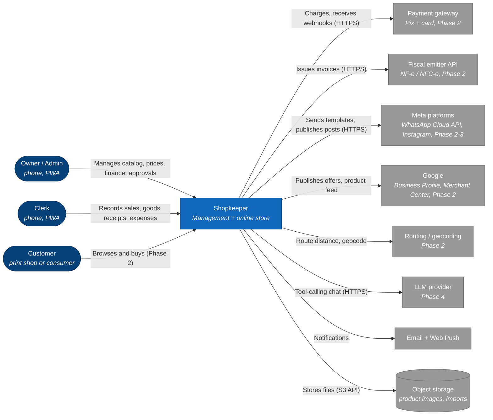
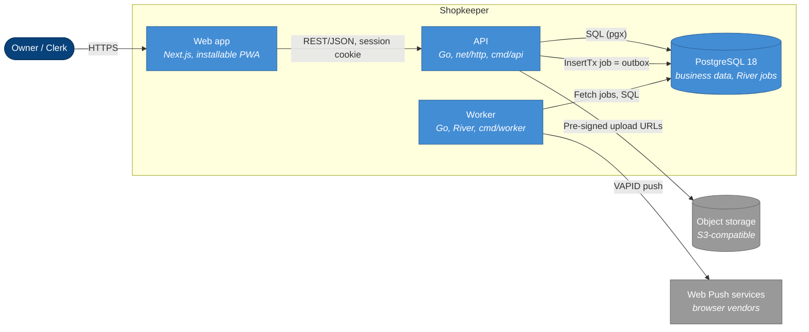
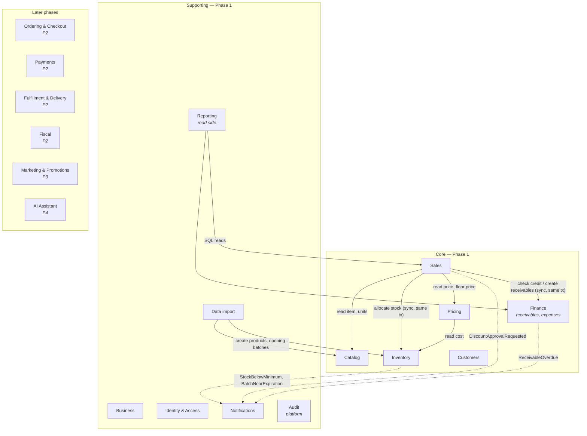

# Shopkeeper — Architecture overview

- **Status:** Proposed (target architecture). The current code only has the `user` context and the platform layer.
- **Date:** 2026-10-15 · **Reference commit:** `cacfbf3`
- **Read next:** [data model (Phase 1)](data-model.md) · [backend structure](backend-structure.md) · [external integrations](integrations.md) · [ADRs](../adr/README.md) · [scope review](../analysis/scope-review.md) · [Phase 1 stories](../analysis/phase-1-user-stories.md)

## 1. Quality attributes that drive the design

| Attribute | Target | Where it shows up |
|---|---|---|
| Client isolation | Each client runs its own deployment and database; no client data shares a process or a schema | [ADR 0011](../adr/0011-use-one-deployment-and-database-per-client.md) |
| Stock correctness | Never sell more than is on hand, across all channels | [ADR 0006](../adr/0006-use-batch-based-inventory-with-movement-ledger.md) |
| Money correctness | No floats; deterministic rounding; prices and costs frozen at sale time | [ADR 0005](../adr/0005-use-fixed-point-money-quantity-and-rate.md) |
| Counter-sale speed | 3-item sale recorded in ≤ 30 s on a phone; API p95 ≤ 300 ms | PWA UX, single round trip per sale |
| Auditability | Every change to price, stock, sale or permission answers "who, when, before, after" | `audit_log`, immutable `stock_movements` |
| Operability for one developer | One deployable backend, one database, no extra broker | [ADR 0001](../adr/0001-use-modular-monolith-with-bounded-contexts.md), [ADR 0007](../adr/0007-use-river-on-postgres-for-jobs-and-outbox.md) |
| Reusable as a per-client template | A new client is a new deploy plus configuration (env vars, `business` row, seeded data); new fiscal regimes and providers without rewriting the core | [ADR 0011](../adr/0011-use-one-deployment-and-database-per-client.md), ports/adapters per integration, data-driven tax tables |

**Order of magnitude (10× the first client):** ~10 users, ~5k SKUs, ~500 sales/day, ~20 GB/year including images. A single Postgres instance and a single API process have plenty of room. Designing for 10× (not 1000×) is what keeps this a monolith.

## 2. System context (C4 level 1) — target



Phase 1 talks only to **object storage** and **Web Push**. Everything else is listed so the boundaries are known early.

## 3. Containers (C4 level 2) — Phase 1



- **One Go module, two binaries** (`cmd/api`, `cmd/worker`) built from the same code. They can run in one process at first (`api --with-worker`) and be split when the worker needs its own scaling. Splitting is just a deployment change.
- **No Redis.** Jobs, the outbox and sessions all live in Postgres ([ADR 0007](../adr/0007-use-river-on-postgres-for-jobs-and-outbox.md)). One fewer thing to back up, monitor and pay for.
- **The web app** is a separate container ([ADR 0010](../adr/0010-use-one-nextjs-app-for-admin-pwa-and-storefront.md)). In Phase 2 the same app serves the storefront with SSR on the client's own domain.

## 4. Bounded contexts

The rule for drawing a boundary: **a context owns its tables and its invariants**. Other contexts never write to its tables. They call it through an interface (synchronous, same transaction) when they need an invariant to hold now, and react to its events when they only need a side effect.



Solid arrow = synchronous call through an interface. Dotted arrow = domain event through the outbox.

| Context | Responsibility | Type | Phase |
|---|---|---|---|
| **Business** | Business profile and settings (singleton), locations, counters | Supporting | 1 |
| **Identity & Access** | Users, roles, permissions, sessions | Generic | 1 |
| **Catalog** | Products, variants, units of measure and conversions, categories, brands, images, compatibility | Core | 1 |
| **Inventory** | Stock items, batches, expiry, movements, goods receipts, adjustments, FEFO allocation, (P2) reservations | Core | 1 |
| **Pricing** | Prices per variant × unit, price history, tax profile (Simples), payment fees, pricing calculator, floor price | Core | 1 |
| **Sales** | Counter/WhatsApp sales, items, discounts and approvals, payments, cancellation, sale profit | Core | 1 |
| **Customers** | Customer registry (CPF/CNPJ, contacts, address), credit limit | Supporting | 1 |
| **Finance** | Receivables and their payments, expenses, recurring expenses, (later) payables, cash flow | Core | 1 |
| **Notifications** | In-app notifications, Web Push, alert de-duplication; (P2+) email/WhatsApp channels | Supporting | 1 |
| **Data import** | Spreadsheet upload, column mapping, dry run, error report | Supporting | 1 |
| **Reporting** | Dashboard and reports. Read-only SQL over the other contexts' tables (CQRS-lite, no domain model) | Supporting | 1 |
| **Audit** | Append-only audit log, written by every use case in the same transaction | Platform | 1 |
| Ordering & Checkout | Cart, checkout, online order lifecycle, reservations | Core | 2 |
| Payments | Payment intents, gateway adapters, webhooks, idempotency | Supporting | 2 |
| Fulfillment & Delivery | Delivery fee policy, addresses/geolocation, route sheet, delivery cost | Supporting | 2 |
| Fiscal | Fiscal data per product, invoice issuing through an emitter port, tax regime from the business settings | Generic (plug-in) | 2 |
| Marketing | Promotions (incl. near-expiry), consent (LGPD), campaigns, posts, channels | Supporting | 3 |
| AI Assistant | Conversations, tools, proposals awaiting approval, budgets | Supporting | 4 |

**Why Reporting has no domain model:** dashboards only read and aggregate. Pushing them through aggregates would load whole sales to sum one column. Reporting is allowed to read other contexts' tables with SQL (never write), and it is the **only** context with that exception. If a query becomes slow, a materialized view or a projection fed by events replaces it without touching the other contexts.

**Why Customers is separate from Sales:** Sales, Finance (credit), Marketing (consent) and Ordering (online accounts) all use the customer. Owned by Sales, the customer would turn Sales into a dependency for everyone.

**Why Pricing is separate from Catalog:** a price change has its own rules (floor price, margin alert, history, approval in Phase 3 promotions) and its own permission (owner only). Product description changes do not.

## 5. Aggregates

An aggregate is the unit of consistency: everything inside it is saved in one transaction and protected by one version number.

| Context | Aggregate root | Contains | Key invariants |
|---|---|---|---|
| Business | `Business` | settings, `Location`s | Exactly one business row; at least one active location and exactly one default; discount ceilings 0–100 % |
| Identity | `User` | credentials, role reference | Email unique; password policy; at least one active user with the owner role |
| Identity | `Role` | permission set, `max_discount_rate` | System roles cannot be deleted |
| Catalog | `Product` | `Variant`s, `ProductUnit`s (conversion factors), images | Exactly one base unit; factor of the base unit = 1; every factor > 0; SKU unique; fractional quantities only on units that allow them |
| Catalog | `Category` | parent reference | No cycles |
| Inventory | `StockItem` (variant × location) | `Batch`es | `on_hand = Σ batch.on_hand`; no batch below zero; FEFO order (expiry date, then receipt date) |
| Inventory | `GoodsReceipt` | lines | Lines become batches only when the receipt is posted; posted receipts are immutable |
| Pricing | `VariantPrice` (variant × sale unit) | current price + calculation snapshot | Price > 0; history is append-only |
| Pricing | `TaxProfile` | regime, annex, manual rate, monthly rates | Manual rate overrides the computed one |
| Sales | `Sale` | `SaleItem`s, `SalePayment`s | Σ payments = total; discount ≤ ceiling unless approved; final unit price ≥ floor price; completed sale is immutable except cancellation |
| Sales | `DiscountApproval` | — | Decided once; only by a user with `sales.discount.approve` |
| Customers | `Customer` | addresses, contacts | Document (CPF/CNPJ) valid and unique |
| Finance | `Receivable` | `ReceivablePayment`s | Σ payments ≤ amount; status derived from payments and due date |
| Finance | `Expense` | — | Amount > 0; category kind decides whether it hits the P&L |
| Finance | `RecurringExpense` | — | Generates at most one expense per period (idempotent) |
| Notifications | `Notification` | — | — |
| Data import | `ImportJob` | rows, errors | Commit only after a successful dry run |

**Why `StockItem` and not `Batch` as the aggregate root:** the rule "do not sell more than you have" spans every batch of the item at a location, and FEFO has to look at all of them to choose. Locking one `stock_items` row serializes concurrent sales of the same item, which is exactly the contention we want, and nothing more. Locking batch rows instead would need a consistent lock order across a variable number of rows, which is easy to get wrong and causes deadlocks.

**Why `DiscountApproval` is its own aggregate:** it is decided by another person, on another device, minutes later. Inside `Sale`, the owner's approval would conflict with the clerk's edits on the same version number.

## 6. Domain events

Events are facts in the past tense. They are written to the outbox **in the same transaction** as the change ([ADR 0007](../adr/0007-use-river-on-postgres-for-jobs-and-outbox.md)) and consumed asynchronously by other contexts.

**Important:** an event is never used to keep an invariant. Selling deducts stock in the same transaction through a synchronous call. If stock deduction happened through an event, a sale could be recorded without stock for a few seconds (or forever, if the handler failed). Events are for side effects that can be delayed and retried: notifications, alerts, projections, marketing, AI.

### Phase 1

| Event | Producer | Payload (besides `occurred_at`, `actor_id`) | Consumers (Phase 1 → later) |
|---|---|---|---|
| `ProductCreated` / `ProductUpdated` / `ProductArchived` | Catalog | product id, changed fields | — → storefront cache (P2), Merchant feed (P2) |
| `PriceChanged` | Pricing | variant, unit, old/new price, margin | Audit → storefront cache (P2), marketing (P3) |
| `MarginBelowMinimum` | Pricing | variant, unit, margin, minimum | Notifications |
| `GoodsReceived` | Inventory | receipt id, lines (variant, qty, batch) | Notifications (owner: "receipt with pending cost") |
| `StockAdjusted` | Inventory | stock item, qty delta, reason | Audit |
| `StockBelowMinimum` | Inventory | variant, location, on hand, minimum | Notifications → AI purchase suggestion (P4) |
| `StockReplenished` | Inventory | variant, location | Notifications (closes the open alert) |
| `BatchNearExpiration` | Inventory (daily job) | batch, expiry date, days left, on hand | Notifications → promotion proposal (P3) |
| `BatchExpired` | Inventory (daily job) | batch | Notifications |
| `SaleCompleted` | Sales | sale id, number, channel, total, items | Notifications (optional) → fiscal (P2), marketing (P3), AI (P4) |
| `SaleCancelled` | Sales | sale id, reason | Notifications → fiscal cancellation (P2) |
| `DiscountApprovalRequested` | Sales | approval id, sale, requested rate | Notifications (Web Push to approvers) |
| `DiscountApproved` / `DiscountRejected` | Sales | approval id, decided by | Notifications (back to the clerk) |
| `ReceivableCreated` | Finance | receivable id, customer, due date, amount | — → reminders (P3) |
| `ReceivablePaid` | Finance | receivable id, amount | Notifications (optional) |
| `ReceivableOverdue` | Finance (daily job) | receivable id, days overdue | Notifications → WhatsApp reminder with approval (P3) |
| `ExpenseRecorded` | Finance | expense id, category, amount | — → AI cost analysis (P4) |
| `EffectiveTaxRateRecalculated` | Pricing (monthly job) | period, RBT12, rate | Notifications ("new rate: x %") |
| `UserCreated` / `UserRoleChanged` / `UserDeactivated` | Identity | user, role | Audit; deactivating ends all sessions |
| `ImportCompleted` | Data import | job id, created/updated/failed counts | Notifications |

### Later phases (names reserved now so that payloads are designed once)

`OrderPlaced`, `StockReserved`, `StockReservationExpired`, `PaymentConfirmed`, `PaymentFailed`, `PaymentRefunded`, `InvoiceAuthorized`, `InvoiceRejected`, `InvoiceCancelled`, `DeliveryScheduled`, `DeliveryDispatched`, `DeliveryCompleted`, `PromotionProposed`, `PromotionApproved`, `PromotionEnded`, `ConsentGranted`, `ConsentRevoked`, `PostScheduled`, `PostPublished`, `AssistantProposalCreated`, `SubscriptionChanged`.

**Event envelope** (JSON in the job's args):

```json
{
  "eventId": "0192f0c1-...",          // UUIDv7, also the idempotency key for consumers
  "type": "inventory.stock_below_minimum",
  "version": 1,                        // payload schema version
  "actorId": "...",                    // null for jobs
  "occurredAt": "2026-10-15T14:03:00Z",
  "data": { "variantId": "...", "locationId": "...", "onHand": "3.000", "minimum": "5.000" }
}
```

Consumers must be **idempotent** (the outbox guarantees at-least-once delivery). Each consumer stores processed `eventId`s, or makes its effect naturally idempotent (for example, "open the alert if none is open").

## 7. How contexts talk to each other

1. **Synchronous, same transaction** — when an invariant crosses contexts. Example: `CompleteSale` (Sales) calls `StockAllocator.Allocate` (implemented by Inventory) and `CreditPolicy.Reserve` (implemented by Finance) inside one database transaction. If any of them fails, nothing is saved.
2. **Asynchronous, through events** — for side effects.
3. **Read-only SQL** — only the Reporting context.

The interfaces are declared by the **consumer** (Go idiom, and how `internal/user/application` already does it). Contexts never import each other's packages. The composition root (`cmd/api`) wires the adapters. A lint rule (`depguard`) enforces this, so the boundary is checked by CI and not only by discipline. See [backend structure](backend-structure.md).

## 8. Critical flow — counter sale with discount and FEFO

```mermaid
sequenceDiagram
  autonumber
  actor Clerk
  participant PWA
  participant API as API (Sales.CompleteSale)
  participant Pricing
  participant Inv as Inventory
  participant Fin as Finance
  participant DB as Postgres
  participant W as Worker

  Clerk->>PWA: Scan items, choose Pix, 4 % discount
  PWA->>API: POST /sales (Idempotency-Key)
  API->>DB: BEGIN
  API->>DB: idempotency key already used? -> return the stored sale
  API->>Pricing: current prices + floor prices (variant x unit)
  API->>API: Sale.ApplyDiscount: 4 % <= role ceiling 5 %, price >= floor
  API->>Inv: Allocate(items) ordered by stock item id
  Inv->>DB: SELECT ... FROM stock_items WHERE ... FOR UPDATE
  Inv->>DB: pick batches FEFO, decrement, INSERT stock_movements
  Inv-->>API: allocations (batch, qty, unit cost) -> COGS per line
  opt payment on account
    API->>Fin: CreditPolicy.Reserve(customer, amount)
    Fin->>DB: SELECT customers ... FOR UPDATE; open balance + amount <= limit; no overdue
    Fin->>DB: INSERT receivables (installments)
  end
  API->>DB: INSERT sales, sale_items, sale_payments, audit_log
  API->>DB: INSERT river_job (SaleCompleted, StockBelowMinimum?)
  API->>DB: COMMIT
  API-->>PWA: 201 sale #1234
  W->>DB: fetch jobs
  W->>W: notify owner, open low-stock alert
```

If the discount is above the ceiling, step 6 fails with `422 discount_requires_approval`. The PWA then creates a `DiscountApproval`, the owner gets a Web Push, approves it, and the clerk sends the same sale again with the `approvalId`. The approval is checked again inside the transaction (valid, approved, same sale draft, not used).

## 9. Deployment (Phase 1 suggestion)

Kept short on purpose. The `devops-core` work will decide it.

- One small VM or container service **in São Paulo** (lowest latency to Manaus among the major clouds) running the API + worker container, plus **managed Postgres 18** with daily backups and point-in-time recovery. A restore test every month, scheduled as a job that restores into a scratch database and runs a count query.
- The web app on a platform with an edge network (for example Vercel) or in the same VM.
- S3-compatible storage with no egress fee for images (for example Cloudflare R2).
- Structured logs (`slog` JSON) with `requestId` and `userId` on every line; metrics and error tracking added in 1c.

## 10. What to revisit, and when

| Decision | Revisit when |
|---|---|
| Monolith | One context needs its own scaling or release cadence (e.g. the storefront under a traffic peak that the admin should not feel) |
| One deployment per client | Many clients need the same operation at once (central upgrades, shared reporting) → a new ADR that supersedes [ADR 0011](../adr/0011-use-one-deployment-and-database-per-client.md) |
| River on Postgres | Job throughput above ~1k/s, or Postgres becomes the bottleneck |
| Reporting over live tables | Dashboard p95 > 1 s → materialized views refreshed by jobs |
| No offline mode | Store connectivity problems reported more than once a week |
