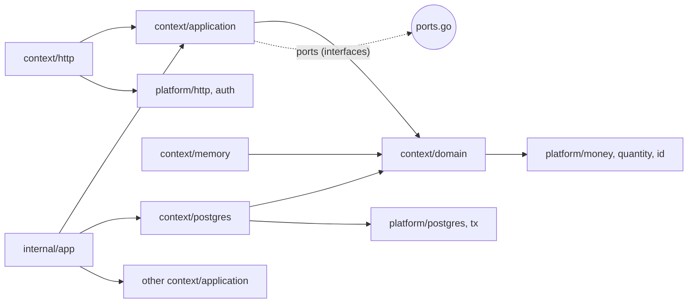

# Backend structure (Go)

- **Status:** Proposed. It **extends** the feature-first layout already in the repository (spec 001: `internal/platform` + `internal/user/{domain,application,postgres,http,memory}`); it does not replace it.
- **Date:** 2026-10-15 · **Reference commit:** `cacfbf3`
- **Decisions:** [ADR 0001](../adr/0001-use-modular-monolith-with-bounded-contexts.md), [ADR 0009](../adr/0009-use-sync-calls-for-cross-context-invariants-and-events-for-side-effects.md)

## 1. Tree

```
cmd/
  api/main.go                 # composition root: config, pool, contexts, routes, middleware
  worker/main.go              # River client: event consumers + periodic jobs (same wiring code)
internal/
  app/                        # wiring shared by both binaries (NewModules(cfg, pool) -> *Modules)
    modules.go
    adapters.go               # glue structs that satisfy one context's port with another's use case
  platform/                   # technical, no business rules (exists today)
    config/  http/  postgres/  id/  pagination/   # existing
    tx/                       # Runner: BEGIN/COMMIT + executor in context
    auth/                     # session middleware, Principal{UserID, RoleID, Permissions}, RequirePermission
    money/                    # Money (cents), Rate (1e-6), rounding (ADR 0005)
    quantity/                 # Quantity (1e-3), UnitCost (1e-6), pgx Scan/Value for numeric
    clock/                    # Clock interface; "today" in the business time zone
    events/                   # Event envelope, Publisher port, River-backed implementation, consumer registry
    jobs/                     # River client setup, queues, periodic job registration
    audit/                    # Recorder port + postgres implementation (same tx)
    idempotency/              # Idempotency-Key header parsing
    storage/                  # ObjectStorage port + S3 adapter (pre-signed URLs)
    crypto/                   # encryption of integration secrets at rest (Phase 2 integrations)
  business/                   # business profile and settings (singleton), locations, counters, setup command
  identity/                   # users, roles, permissions, sessions
  catalog/
  inventory/
  pricing/
  customer/
  sales/
  finance/
  notification/
  importer/
  reporting/                  # read-only queries; no domain/ folder
migrations/                   # golang-migrate, one numbered pair per change (exists today)
test/
  integration/  e2e/  testutil/   # exists today
web/                          # Next.js PWA (ADR 0010)
```

## 2. Inside one context

Same shape as `internal/user` today, so nobody has to learn two styles.

```
internal/sales/
  domain/                     # package sales — pure Go, imports only stdlib + platform/money|quantity|id
    sale.go                   # aggregate root: NewSale, AddItem, ApplyDiscount, AddPayment, Complete, Cancel
    sale_item.go
    discount.go               # DiscountPolicy (value object): ceiling, floor price check
    discount_approval.go      # aggregate
    payment.go
    events.go                 # SaleCompleted, SaleCancelled, DiscountApprovalRequested, ...
    errors.go                 # ErrDiscountRequiresApproval, ErrBelowFloorPrice, ErrPaymentsMismatch, ...
    repository.go             # SaleRepository, DiscountApprovalRepository
    sale_test.go
  application/                # package salesapp — one use case per file, Execute(ctx, in) (out, err)
    complete_sale.go
    complete_sale_test.go     # uses memory repos + fake ports
    cancel_sale.go
    request_discount_approval.go
    decide_discount_approval.go
    ports.go                  # interfaces this context NEEDS from others (consumer side):
                              #   StockAllocator, CreditPolicy, PriceBook, CatalogReader
  postgres/                   # package salespg — SQL with pgx; maps rows <-> domain
    sale_repository.go
    discount_approval_repository.go
  http/                       # package saleshttp — handlers, request/response DTOs, error mapping, routes
    routes.go                 # Register(mux, deps)
    complete_sale_handler.go
    dto.go                    # response DTOs respect permissions (no cost fields without stock.cost.view)
    errors.go                 # domain error -> {status, code}
  memory/                     # package salesmem — in-memory repos for use case tests
  consumers/                  # package salesconsumers — event handlers this context reacts to (if any)
```

**Why one use case per file with `Execute`:** it is the existing convention (`RegisterUser`, `EditUser`). Each file has one reason to change (SRP) and one test file. The interfaces a use case needs are small and declared next to it (ISP), as `registerUserRepository` already is.

## 3. Dependency rules



1. `domain` imports nothing outside stdlib and the value packages of `platform` (`money`, `quantity`, `id`, `clock`). No pgx, no net/http, no JSON tags.
2. `application` imports its own `domain` and `platform` ports (`tx`, `events`, `audit`). It **never imports another context**. What it needs from another context is an interface in `ports.go`.
3. `postgres` and `http` are adapters; they import their own `domain`/`application`.
4. Only `internal/app` (composition) imports several contexts, to build adapters such as:

```go
// internal/app/adapters.go
// stockAllocatorAdapter lets Sales allocate stock without importing Inventory's types.
type stockAllocatorAdapter struct{ allocate *inventoryapp.AllocateStock }

func (a stockAllocatorAdapter) Allocate(ctx context.Context, lines []salesapp.AllocationRequest) ([]salesapp.Allocation, error) {
	// translate salesapp types <-> inventoryapp types; no business logic here
}
```

5. Enforced by `depguard` in `golangci.yml`: a rule per context that denies `internal/<other-context>/...` except from `internal/app` and `cmd`. CI fails on a violation.

**Why the consumer declares the interface:** Sales describes what it needs (`Allocate(lines) → allocations`) in its own words. Inventory can change its internals freely, and the Sales use case tests use a fake without starting Inventory. This is the Dependency Inversion principle applied between modules, and it is what makes a later extraction into a separate service possible (the adapter becomes an HTTP client).

## 4. Transactions

```go
// platform/tx
type Runner interface {
	// InTx begins a transaction, stores the pgx.Tx in ctx, commits if fn returns nil
	// and rolls back on error or panic.
	InTx(ctx context.Context, fn func(ctx context.Context) error) error
}

// platform/postgres
// Executor returns the transaction in ctx, or the pool when there is none.
func Executor(ctx context.Context) DBTX
```

- The **use case** decides the transaction boundary (`CompleteSale` wraps allocation + credit + save + audit + outbox in one `InTx`).
- Repositories never hold the pool themselves; they use `postgres.Executor(ctx)`, so the same repository works inside or outside a transaction.
- A use case that changes more than one row or aggregate, or writes audit/outbox records, must run in `InTx`. A single read can run without one.
- The acting user comes from the **session**, never from the request body or a header the client controls.

**Why the transaction travels in the context:** cross-context use cases need several repositories (from different packages) to share one transaction. Passing `pgx.Tx` through every signature would leak pgx into `application`. The trade-off: it is implicit, so use case tests assert that multi-write flows run inside the fake runner.

## 5. Errors and HTTP

The existing envelope (spec 002) is kept: `{"error": {"code": "...", "message": "...", "requestId": "..."}}`.

| Situation | Status | Example code |
|---|---|---|
| Validation of input shape | 400 | `invalid_request` |
| No session / expired | 401 | `unauthenticated` |
| Missing permission | 403 | `forbidden` |
| Entity not found | 404 | `product_not_found` |
| Stale `version` | 409 | `version_conflict` |
| Idempotency key reused with a different body | 409 | `idempotency_key_mismatch` |
| Business rule | 422 | `insufficient_stock`, `discount_requires_approval`, `below_floor_price`, `credit_limit_exceeded`, `customer_has_overdue_installments` |

Messages for the clerk never contain costs: `below_floor_price` says "Desconto acima do permitido para este item", not "custo R$ 61,20".

## 6. Testing strategy

| Level | What | Tools |
|---|---|---|
| Domain unit (TDD first) | Aggregates, value objects, calculators (FEFO pick, discount policy, Simples rate, markup/margin) | stdlib `testing`, table tests |
| Use case | Orchestration, ports called in the right order, events emitted, audit written | `memory` repos + fakes for ports |
| Integration | SQL, constraints, row locks, concurrent sales | real Postgres 18 (existing `postgres-test` compose service; testcontainers is an option for CI isolation) |
| Concurrency | Two goroutines selling the last unit: exactly one succeeds | integration, `sync.WaitGroup` + barrier |
| E2E API | Main flows through HTTP with a real session | existing `test/e2e` |
| Contract (Phase 2) | Gateway/emitter adapters against recorded responses | `httptest.Server` |

## 7. What changes in the existing code (first specs)

1. Rename `internal/user` → `internal/identity` (package names `identity`, `identityapp`, `identitypg`, ...).
2. Add the `business` context (singleton profile, locations, counters) and the setup command; replace `users.role` with `users.role_id` (expand → migrate data → contract).
3. Add `platform/tx` and `platform/auth`; make every existing repository use `Executor(ctx)`.
4. Replace the `owner`/`clerk` role check with permissions.
5. Add the `depguard` rules before the second business context lands.
