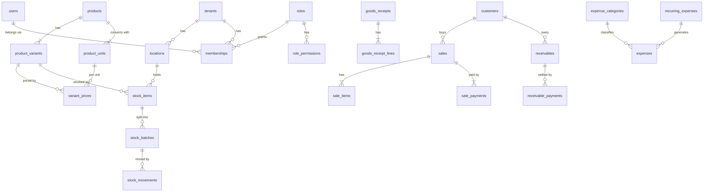

# Data model — Phase 1 (PostgreSQL 18)

- **Status:** Proposed. This is the target schema for Phase 1; it becomes migrations story by story (see [Phase 1 stories](../analysis/phase-1-user-stories.md)), not in one big migration.
- **Date:** 2026-10-15 · **Reference commit:** `cacfbf3`
- **Decisions behind it:** [ADR 0002](../adr/0002-use-shared-schema-multi-tenancy-with-rls.md) (tenancy), [ADR 0003](../adr/0003-use-global-identity-with-tenant-memberships-and-rbac.md) (identity), [ADR 0005](../adr/0005-use-fixed-point-money-quantity-and-rate.md) (numbers), [ADR 0006](../adr/0006-use-batch-based-inventory-with-movement-ledger.md) (inventory), [ADR 0008](../adr/0008-compute-simples-effective-rate-from-versioned-brackets.md) (tax).

## 1. Conventions

| Topic | Rule | Why |
|---|---|---|
| Names | English, `snake_case`, plural tables; constraints `<table>_<column>_<rule>_check`, indexes `<table>_<columns>_idx` / `_unique_idx` | Matches the existing migrations (spec 006). |
| Primary keys | `PRIMARY KEY (tenant_id, id)`; `id uuid` is UUIDv7 generated by the app (`uuid.NewV7()`), `uuidv7()` as a default for seeds | UUIDv7 is time-ordered, so B-tree inserts stay local. A composite PK gives the `(tenant_id, id)` unique index that composite FKs need, without a second index. |
| Foreign keys | Composite: `FOREIGN KEY (tenant_id, product_id) REFERENCES products (tenant_id, id)` | RLS does **not** apply to FK checks. A plain FK would accept a product id from another tenant. A composite FK makes that impossible. |
| FKs between contexts | Only toward **upstream reference** contexts (Tenancy, Identity, Catalog, Customers). Links to other contexts are plain ids (`source_type`, `source_id`) with an index. | Keeps contexts separable: Inventory never depends on the Sales schema. |
| Money | `bigint`, suffix `_cents` | No floats; exact sums. |
| Quantities | `numeric(14,3)` in the **unit named by the column** (`base_quantity` = base unit) | 2.5 m and 0.125 kg are real cases. Three decimals cover mm and grams. |
| Unit costs | `numeric(18,6)` reais per **base unit** | R$ 37.33 per box of 500 sheets is R$ 0.074660 per sheet. With 2 decimals the error would be R$ 2.50 per box. |
| Rates | `numeric(7,6)` as a fraction (`0.050000` = 5 %), suffix `_rate` | One representation for discounts, fees, tax rates and margins. 6 decimals hold the Simples effective rate (6.728 %). |
| Business dates | `date` in the tenant's time zone (`America/Manaus`); instants are `timestamptz` | "Due today" and "expires in 7 days" are calendar facts in Manaus, not UTC. |
| Optimistic locking | `version int` on aggregate roots | Same pattern as `users` today (409 on stale version, spec 002). |
| Append-only tables | `audit_log`, `stock_movements`: the app role has no `UPDATE`/`DELETE` | The ledger and the audit trail cannot be rewritten by the application, even by a bug. |

### Roles and RLS setup

```sql
-- Created once by infrastructure, not by app migrations.
CREATE ROLE shopkeeper_migrator LOGIN BYPASSRLS;  -- owns the tables, runs migrations
CREATE ROLE shopkeeper_app      LOGIN;            -- the API and the worker; no BYPASSRLS, not owner

-- Returns NULL when the setting is missing, so every policy fails closed.
CREATE FUNCTION app_current_tenant() RETURNS uuid
LANGUAGE sql STABLE AS $$
  SELECT nullif(current_setting('app.tenant_id', true), '')::uuid
$$;
```

Every tenant-scoped table gets the same three statements (shown once here, implied below):

```sql
ALTER TABLE <t> ENABLE ROW LEVEL SECURITY;
ALTER TABLE <t> FORCE ROW LEVEL SECURITY;
CREATE POLICY <t>_tenant_isolation ON <t>
  USING (tenant_id = app_current_tenant())
  WITH CHECK (tenant_id = app_current_tenant());
```

The application sets the tenant **per transaction**, never per session:

```sql
BEGIN;
SELECT set_config('app.tenant_id', $1, true);  -- true = local to this transaction
-- ... queries ...
COMMIT;
```

`SET` without `LOCAL` would stay on the pooled connection and leak the tenant into the next request that borrows it. `set_config(..., true)` is reset at `COMMIT`/`ROLLBACK`.

**Guard test** (integration suite): this query must return no rows, so a new table without RLS fails CI.

```sql
SELECT c.relname
FROM pg_class c
JOIN pg_namespace n ON n.oid = c.relnamespace AND n.nspname = 'public'
JOIN pg_attribute a ON a.attrelid = c.oid AND a.attname = 'tenant_id' AND NOT a.attisdropped
WHERE c.relkind IN ('r', 'p')
  AND NOT (c.relrowsecurity AND c.relforcerowsecurity);
```

## 2. Entity-relationship overview (core of Phase 1)

The full diagram (every Phase 1 table grouped by context, FKs and plain-id links, plus the schema logic: RLS, units, FEFO, pricing floor, the sale transaction, P&L and the Simples rate) is in [`data-model.excalidraw`](data-model.excalidraw). Open it at excalidraw.com (*Open* → file) or with the Excalidraw extension in VS Code/JetBrains. The Mermaid diagram below is the short version that renders on GitHub.



## 3. Schema by context

### 3.1 Tenancy

```sql
CREATE TABLE tenants (
    id           uuid        PRIMARY KEY,
    slug         text        NOT NULL,
    legal_name   text        NOT NULL,
    trade_name   text        NOT NULL,
    document     text,                                  -- CNPJ, digits only
    plan         text        NOT NULL DEFAULT 'internal',
    status       text        NOT NULL DEFAULT 'active',
    time_zone    text        NOT NULL DEFAULT 'America/Manaus',
    locale       text        NOT NULL DEFAULT 'pt-BR',
    version      int         NOT NULL DEFAULT 1,
    created_at   timestamptz NOT NULL,
    updated_at   timestamptz NOT NULL,
    CONSTRAINT tenants_status_valid_check CHECK (status IN ('active', 'suspended', 'closed'))
);
CREATE UNIQUE INDEX tenants_slug_unique_idx ON tenants (lower(slug));
-- RLS on tenants uses id instead of tenant_id:
--   USING (id = app_current_tenant())
-- Jobs that iterate over tenants call a SECURITY DEFINER function owned by the migrator:
--   list_active_tenant_ids() RETURNS SETOF uuid

CREATE TABLE tenant_settings (
    tenant_id                  uuid         PRIMARY KEY REFERENCES tenants (id),
    default_max_discount_rate  numeric(7,6) NOT NULL DEFAULT 0.05,
    min_margin_rate            numeric(7,6) NOT NULL DEFAULT 0,
    floor_price_policy         text         NOT NULL DEFAULT 'min_margin',
    fixed_cost_allocation_rate numeric(7,6),           -- NULL = computed from last 3 months
    expiry_alert_days          int[]        NOT NULL DEFAULT '{30,15,7}',
    credit_overdue_policy      text         NOT NULL DEFAULT 'block',
    logo_key                   text,
    primary_color              text,
    version                    int          NOT NULL DEFAULT 1,
    updated_at                 timestamptz  NOT NULL,
    CONSTRAINT tenant_settings_floor_price_policy_valid_check CHECK (floor_price_policy IN ('cost', 'min_margin')),
    CONSTRAINT tenant_settings_credit_overdue_policy_valid_check CHECK (credit_overdue_policy IN ('block', 'warn'))
);

CREATE TABLE locations (
    tenant_id  uuid        NOT NULL REFERENCES tenants (id),
    id         uuid        NOT NULL,
    name       text        NOT NULL,
    is_default boolean     NOT NULL DEFAULT false,
    is_active  boolean     NOT NULL DEFAULT true,
    zip_code   text, street text, number text, district text, city text, state char(2),
    latitude   numeric(9,6), longitude numeric(9,6),
    created_at timestamptz NOT NULL,
    PRIMARY KEY (tenant_id, id)
);
CREATE UNIQUE INDEX locations_default_unique_idx ON locations (tenant_id) WHERE is_default;

-- Human-friendly sequential numbers per tenant (sale #1234, receipt #87).
-- Incremented with UPDATE ... RETURNING inside the business transaction: gap-free and serialized per counter.
CREATE TABLE tenant_counters (
    tenant_id  uuid   NOT NULL REFERENCES tenants (id),
    name       text   NOT NULL,          -- 'sale', 'goods_receipt'
    next_value bigint NOT NULL DEFAULT 1,
    PRIMARY KEY (tenant_id, name)
);
```

**Why a single default location now:** every stock key is `(variant, location)`. Adding the location later would change the key of the most-used table. Today it costs one row.

### 3.2 Identity & Access

```sql
-- Global identity: one person, one login, possibly many tenants (owner of two stores, accountant).
-- Not tenant-scoped, so no RLS. Only the Identity repositories read it.
-- Migration from today: users.role moves into memberships, then the column is dropped.
CREATE TABLE users (
    id            uuid        PRIMARY KEY,
    name          text        NOT NULL,
    email         text        NOT NULL,
    password_hash text        NOT NULL,
    is_active     boolean     NOT NULL DEFAULT true,
    must_change_password boolean NOT NULL DEFAULT false,  -- set when the owner creates the account
    totp_secret   bytea,                       -- encrypted; Phase 1.x
    last_login_at timestamptz,
    version       int         NOT NULL DEFAULT 1,
    created_at    timestamptz NOT NULL,
    updated_at    timestamptz NOT NULL,
    CONSTRAINT users_name_not_blank_check CHECK (length(btrim(name)) > 0)
);
CREATE UNIQUE INDEX users_email_unique_idx ON users (lower(email));

-- Catalog of permissions, seeded by migrations. The code defines them; the table gives FK integrity.
CREATE TABLE permissions (
    code        text PRIMARY KEY,              -- 'sales.create', 'pricing.cost.view', ...
    description text NOT NULL
);

CREATE TABLE roles (
    tenant_id         uuid         NOT NULL REFERENCES tenants (id),
    id                uuid         NOT NULL,
    name              text         NOT NULL,
    is_system         boolean      NOT NULL DEFAULT false,   -- 'owner', 'clerk': cannot be deleted
    max_discount_rate numeric(7,6),                         -- NULL = tenant default; owner seeded with 1.0
    version           int          NOT NULL DEFAULT 1,
    created_at        timestamptz  NOT NULL,
    PRIMARY KEY (tenant_id, id)
);
CREATE UNIQUE INDEX roles_name_unique_idx ON roles (tenant_id, lower(name));

CREATE TABLE role_permissions (
    tenant_id       uuid NOT NULL,
    role_id         uuid NOT NULL,
    permission_code text NOT NULL REFERENCES permissions (code),
    PRIMARY KEY (tenant_id, role_id, permission_code),
    FOREIGN KEY (tenant_id, role_id) REFERENCES roles (tenant_id, id) ON DELETE CASCADE
);

CREATE TABLE memberships (
    tenant_id  uuid        NOT NULL REFERENCES tenants (id),
    id         uuid        NOT NULL,
    user_id    uuid        NOT NULL REFERENCES users (id),
    role_id    uuid        NOT NULL,
    status     text        NOT NULL DEFAULT 'active',
    created_at timestamptz NOT NULL,
    revoked_at timestamptz,
    version    int         NOT NULL DEFAULT 1,
    PRIMARY KEY (tenant_id, id),
    FOREIGN KEY (tenant_id, role_id) REFERENCES roles (tenant_id, id),
    CONSTRAINT memberships_status_valid_check CHECK (status IN ('active', 'revoked'))
);
CREATE UNIQUE INDEX memberships_user_unique_idx ON memberships (tenant_id, user_id);
CREATE INDEX memberships_user_id_idx ON memberships (user_id);  -- "which tenants can I enter?" (via SECURITY DEFINER fn)

-- Opaque session tokens (ADR 0004). The cookie holds the token; the database holds only its SHA-256.
CREATE TABLE sessions (
    id                  uuid        PRIMARY KEY,
    user_id             uuid        NOT NULL REFERENCES users (id),
    token_hash          bytea       NOT NULL,
    active_tenant_id    uuid        REFERENCES tenants (id),
    created_at          timestamptz NOT NULL,
    last_seen_at        timestamptz NOT NULL,
    idle_expires_at     timestamptz NOT NULL,   -- sliding, e.g. 12 h
    absolute_expires_at timestamptz NOT NULL,   -- e.g. 30 days
    revoked_at          timestamptz,
    ip                  inet,
    user_agent          text
);
CREATE UNIQUE INDEX sessions_token_hash_unique_idx ON sessions (token_hash);
CREATE INDEX sessions_user_id_idx ON sessions (user_id) WHERE revoked_at IS NULL;
```

**Phase 1 permission catalog** (the two system roles are seeded per tenant):

| Permission | Owner | Clerk |
|---|:-:|:-:|
| `catalog.read`, `stock.read`, `customers.read` | ✅ | ✅ |
| `catalog.write`, `catalog.import` | ✅ | — |
| `stock.receive`, `stock.adjust` | ✅ | ✅ receive / — adjust |
| `stock.cost.view` (batch cost, COGS) | ✅ | — |
| `pricing.read` (sale prices) | ✅ | ✅ |
| `pricing.write`, `pricing.calculator`, `pricing.tax.write` | ✅ | — |
| `sales.create`, `sales.read` | ✅ | ✅ |
| `sales.create_on_account` (credit sale within limit) | ✅ | ✅ |
| `sales.cancel` | ✅ | — |
| `sales.discount.approve` | ✅ | — |
| `sales.profit.view` | ✅ | — |
| `customers.write` | ✅ | ✅ |
| `customers.credit_limit.write` | ✅ | — |
| `finance.receivables.read`, `finance.receivables.collect` | ✅ | ✅ |
| `finance.expenses.create` | ✅ | ✅ |
| `finance.expenses.read_all`, `finance.reports` | ✅ | — |
| `dashboard.profit` | ✅ | — |
| `users.manage`, `settings.write`, `audit.read` | ✅ | — |

`stock.cost.view` is enforced in the **response mapping**: a clerk's JSON has no `unitCost` field at all (absent, not `null`). Hiding it only in the UI would leak it to anyone who opens the browser's network tab.

### 3.3 Audit (platform)

```sql
CREATE TABLE audit_log (
    tenant_id     uuid        NOT NULL REFERENCES tenants (id),
    id            uuid        NOT NULL,
    actor_user_id uuid,                          -- NULL for jobs
    action        text        NOT NULL,          -- 'pricing.price_changed', 'sales.sale_cancelled', ...
    entity_type   text        NOT NULL,
    entity_id     uuid        NOT NULL,
    before        jsonb,
    after         jsonb,
    request_id    text,
    occurred_at   timestamptz NOT NULL,
    PRIMARY KEY (tenant_id, id)
);
CREATE INDEX audit_log_entity_idx ON audit_log (tenant_id, entity_type, entity_id, occurred_at DESC);
CREATE INDEX audit_log_actor_idx  ON audit_log (tenant_id, actor_user_id, occurred_at DESC);
REVOKE UPDATE, DELETE ON audit_log FROM shopkeeper_app;
```

Written by the use case **in the same transaction** as the change. If it were written by an event handler, a change could exist without its audit record.

### 3.4 Catalog

```sql
-- Global reference data, seeded: un, cx, pct, rl, m, m2, folha, kg, g, l, ml, par, kit, h.
CREATE TABLE units (
    code            text    PRIMARY KEY,
    dimension       text    NOT NULL,  -- 'count', 'length', 'area', 'mass', 'volume', 'time'
    allows_fraction boolean NOT NULL   -- default for new product units; 'm' true, 'un' false
);

CREATE TABLE categories (
    tenant_id uuid    NOT NULL REFERENCES tenants (id),
    id        uuid    NOT NULL,
    parent_id uuid,
    name      text    NOT NULL,
    slug      text    NOT NULL,
    position  int     NOT NULL DEFAULT 0,
    is_active boolean NOT NULL DEFAULT true,
    PRIMARY KEY (tenant_id, id),
    FOREIGN KEY (tenant_id, parent_id) REFERENCES categories (tenant_id, id)
);
CREATE UNIQUE INDEX categories_slug_unique_idx ON categories (tenant_id, slug);

CREATE TABLE brands (
    tenant_id uuid NOT NULL REFERENCES tenants (id),
    id        uuid NOT NULL,
    name      text NOT NULL,
    PRIMARY KEY (tenant_id, id)
);
CREATE UNIQUE INDEX brands_name_unique_idx ON brands (tenant_id, lower(name));

CREATE TABLE products (
    tenant_id         uuid        NOT NULL REFERENCES tenants (id),
    id                uuid        NOT NULL,
    kind              text        NOT NULL DEFAULT 'goods',   -- 'goods' | 'service'; 'kit' in Phase 1.x
    name              text        NOT NULL,
    slug              text        NOT NULL,
    description       text,
    category_id       uuid,
    brand_id          uuid,
    base_unit_code    text        NOT NULL REFERENCES units (code),
    tracks_stock      boolean     NOT NULL DEFAULT true,
    tracks_expiry     boolean     NOT NULL DEFAULT false,
    is_visible_online boolean     NOT NULL DEFAULT false,
    compatible_with   text[]      NOT NULL DEFAULT '{}',      -- 'Epson i3200', 'DX5', ... (G20)
    ncm               text,                                   -- fiscal data: optional now, required in Phase 2
    cest              text,
    status            text        NOT NULL DEFAULT 'active',
    version           int         NOT NULL DEFAULT 1,
    created_at        timestamptz NOT NULL,
    updated_at        timestamptz NOT NULL,
    PRIMARY KEY (tenant_id, id),
    FOREIGN KEY (tenant_id, category_id) REFERENCES categories (tenant_id, id),
    FOREIGN KEY (tenant_id, brand_id)    REFERENCES brands (tenant_id, id),
    CONSTRAINT products_kind_valid_check     CHECK (kind IN ('goods', 'service')),
    CONSTRAINT products_status_valid_check   CHECK (status IN ('active', 'archived')),
    CONSTRAINT products_service_stock_check  CHECK (kind <> 'service' OR (NOT tracks_stock AND NOT tracks_expiry)),
    CONSTRAINT products_name_not_blank_check CHECK (length(btrim(name)) > 0)
);
CREATE UNIQUE INDEX products_slug_unique_idx ON products (tenant_id, slug);
CREATE EXTENSION IF NOT EXISTS pg_trgm;
CREATE INDEX products_name_trgm_idx ON products USING gin (name gin_trgm_ops);  -- counter search "tinta eco"

-- The sellable/stockable thing. A product with no real variations has exactly one variant.
CREATE TABLE product_variants (
    tenant_id  uuid        NOT NULL,
    id         uuid        NOT NULL,
    product_id uuid        NOT NULL,
    sku        text        NOT NULL,
    barcode    text,
    attributes jsonb       NOT NULL DEFAULT '{}',   -- {"color": "Magenta", "volume": "1 L"}
    status     text        NOT NULL DEFAULT 'active',
    version    int         NOT NULL DEFAULT 1,
    created_at timestamptz NOT NULL,
    PRIMARY KEY (tenant_id, id),
    FOREIGN KEY (tenant_id, product_id) REFERENCES products (tenant_id, id)
);
CREATE UNIQUE INDEX product_variants_sku_unique_idx     ON product_variants (tenant_id, lower(sku));
CREATE UNIQUE INDEX product_variants_barcode_unique_idx ON product_variants (tenant_id, barcode) WHERE barcode IS NOT NULL;
CREATE INDEX product_variants_product_id_idx ON product_variants (tenant_id, product_id);

-- Unit conversions are physical facts of the product, shared by all its variants.
-- factor = how many base units fit in this unit (box = 500 sheets, roll = 50 m).
CREATE TABLE product_units (
    tenant_id        uuid          NOT NULL,
    id               uuid          NOT NULL,
    product_id       uuid          NOT NULL,
    unit_code        text          NOT NULL REFERENCES units (code),
    label            text,                          -- "Caixa c/ 500", shown at the counter
    factor           numeric(14,3) NOT NULL,
    is_base          boolean       NOT NULL DEFAULT false,
    is_purchase_unit boolean       NOT NULL DEFAULT false,
    is_sale_unit     boolean       NOT NULL DEFAULT true,
    allows_fraction  boolean       NOT NULL,
    PRIMARY KEY (tenant_id, id),
    FOREIGN KEY (tenant_id, product_id) REFERENCES products (tenant_id, id) ON DELETE CASCADE,
    CONSTRAINT product_units_factor_positive_check CHECK (factor > 0),
    CONSTRAINT product_units_base_factor_check     CHECK (NOT is_base OR factor = 1)
);
CREATE UNIQUE INDEX product_units_unit_unique_idx ON product_units (tenant_id, product_id, unit_code);
CREATE UNIQUE INDEX product_units_base_unique_idx ON product_units (tenant_id, product_id) WHERE is_base;

CREATE TABLE product_images (
    tenant_id   uuid NOT NULL,
    id          uuid NOT NULL,
    product_id  uuid NOT NULL,
    storage_key text NOT NULL,
    position    int  NOT NULL DEFAULT 0,
    alt_text    text,
    PRIMARY KEY (tenant_id, id),
    FOREIGN KEY (tenant_id, product_id) REFERENCES products (tenant_id, id) ON DELETE CASCADE
);
```

**Worked example — fractional sale (the brief's requirement):**

| Product | Base unit | Units (factor) | Stock kept in | Prices (per variant × unit) |
|---|---|---|---|---|
| Photo paper A4 | `folha` | `folha` (1), `cx` (500, purchase + sale) | sheets | folha R$ 0.25 · cx R$ 95.00 |
| Adhesive vinyl 1.27 m | `m` (fraction ✅) | `m` (1), `rl` (50, purchase + sale) | meters | m R$ 18.00 · rl R$ 750.00 |
| Eco Gold ink 1 L (4 colors) | `un` | `un` (1), `cx` (12, purchase) | units | un R$ 89.00 per color variant |
| Print head i3200 | `un` | `un` (1) | units | R$ 9,300.00 (Pix) |
| Maintenance visit | `h` (service) | `h` (1) | — | R$ 150.00 |

Selling 2.5 m of vinyl stores `quantity = 2.500` in unit `m`, `base_quantity = 2.500`. Selling 1 box of paper stores `quantity = 1.000` in `cx`, `base_quantity = 500.000`. Stock moves in base units only. The price of the box is its own price (R$ 95.00), not 500 × R$ 0.25 (R$ 125.00): this is the "fractioned costs proportionally more" rule from the brief.

**Why `variants` already in Phase 1:** stock, prices and sale items point at the variant. Adding variants later would move every one of those foreign keys. The import creates one variant per spreadsheet line, and grouping colors under one product is optional.

### 3.5 Inventory

```sql
CREATE TABLE suppliers (
    tenant_id      uuid    NOT NULL REFERENCES tenants (id),
    id             uuid    NOT NULL,
    name           text    NOT NULL,
    document       text,
    phone          text,
    email          text,
    lead_time_days int,
    notes          text,
    is_active      boolean NOT NULL DEFAULT true,
    PRIMARY KEY (tenant_id, id)
);

-- Aggregate root: one row per variant x location. Locked FOR UPDATE by every allocation.
CREATE TABLE stock_items (
    tenant_id    uuid          NOT NULL,
    id           uuid          NOT NULL,
    variant_id   uuid          NOT NULL,
    location_id  uuid          NOT NULL,
    on_hand      numeric(14,3) NOT NULL DEFAULT 0,   -- cached sum of batches, base unit
    min_quantity numeric(14,3),                      -- low-stock alert threshold
    version      int           NOT NULL DEFAULT 1,
    updated_at   timestamptz   NOT NULL,
    PRIMARY KEY (tenant_id, id),
    FOREIGN KEY (tenant_id, variant_id)  REFERENCES product_variants (tenant_id, id),
    FOREIGN KEY (tenant_id, location_id) REFERENCES locations (tenant_id, id),
    CONSTRAINT stock_items_on_hand_non_negative_check CHECK (on_hand >= 0)
);
CREATE UNIQUE INDEX stock_items_variant_location_unique_idx ON stock_items (tenant_id, variant_id, location_id);
CREATE INDEX stock_items_low_stock_idx ON stock_items (tenant_id) WHERE min_quantity IS NOT NULL AND on_hand <= min_quantity;

CREATE TABLE stock_batches (
    tenant_id             uuid          NOT NULL,
    id                    uuid          NOT NULL,
    stock_item_id         uuid          NOT NULL,
    origin                text          NOT NULL,         -- 'receipt' | 'opening_balance' | 'adjustment' | 'return'
    goods_receipt_line_id uuid,
    supplier_id           uuid,
    lot_code              text,
    received_at           timestamptz   NOT NULL,
    expires_on            date,                           -- NULL = no expiry (FIFO by received_at)
    unit_cost             numeric(18,6),                  -- per base unit; NULL = cost pending (G1)
    quantity_received     numeric(14,3) NOT NULL,
    on_hand               numeric(14,3) NOT NULL,
    created_at            timestamptz   NOT NULL,
    PRIMARY KEY (tenant_id, id),
    FOREIGN KEY (tenant_id, stock_item_id) REFERENCES stock_items (tenant_id, id),
    FOREIGN KEY (tenant_id, supplier_id)   REFERENCES suppliers (tenant_id, id),
    CONSTRAINT stock_batches_on_hand_range_check CHECK (on_hand >= 0 AND on_hand <= quantity_received),
    CONSTRAINT stock_batches_unit_cost_non_negative_check CHECK (unit_cost IS NULL OR unit_cost >= 0)
);
-- FEFO/FIFO pick order, only batches with something left.
CREATE INDEX stock_batches_pick_order_idx
    ON stock_batches (tenant_id, stock_item_id, expires_on NULLS LAST, received_at)
    WHERE on_hand > 0;
-- Daily expiry scan.
CREATE INDEX stock_batches_expiry_idx ON stock_batches (tenant_id, expires_on) WHERE on_hand > 0 AND expires_on IS NOT NULL;

-- Immutable ledger. Stock is history; on_hand columns are projections that can be rebuilt from it.
CREATE TABLE stock_movements (
    tenant_id     uuid          NOT NULL,
    id            uuid          NOT NULL,
    stock_item_id uuid          NOT NULL,
    batch_id      uuid          NOT NULL,
    kind          text          NOT NULL,
    quantity      numeric(14,3) NOT NULL,       -- signed, base unit: + in, - out
    unit_cost     numeric(18,6),                -- snapshot of the batch cost at the time
    source_type   text,                         -- 'sale_item' | 'goods_receipt_line' | 'adjustment' | 'import'
    source_id     uuid,                         -- plain id: no FK to other contexts
    reason_code   text,                         -- 'count', 'damage', 'loss', 'expired', 'found', 'other'
    note          text,
    actor_user_id uuid,
    occurred_at   timestamptz   NOT NULL,
    PRIMARY KEY (tenant_id, id),
    FOREIGN KEY (tenant_id, stock_item_id) REFERENCES stock_items (tenant_id, id),
    FOREIGN KEY (tenant_id, batch_id)      REFERENCES stock_batches (tenant_id, id),
    CONSTRAINT stock_movements_kind_valid_check CHECK (kind IN
        ('opening_balance', 'receipt', 'sale', 'sale_cancellation', 'adjustment', 'loss', 'return')),
    CONSTRAINT stock_movements_quantity_non_zero_check CHECK (quantity <> 0)
);
CREATE INDEX stock_movements_item_idx   ON stock_movements (tenant_id, stock_item_id, occurred_at DESC);
CREATE INDEX stock_movements_source_idx ON stock_movements (tenant_id, source_type, source_id);
REVOKE UPDATE, DELETE ON stock_movements FROM shopkeeper_app;

CREATE TABLE goods_receipts (
    tenant_id       uuid        NOT NULL,
    id              uuid        NOT NULL,
    number          bigint      NOT NULL,
    supplier_id     uuid,
    location_id     uuid        NOT NULL,
    invoice_number  text,
    invoice_key     text,                         -- NF-e access key (44 digits), optional
    received_at     timestamptz NOT NULL,
    status          text        NOT NULL DEFAULT 'draft',  -- 'draft' | 'posted' | 'cancelled'
    notes           text,
    created_by      uuid        NOT NULL,
    posted_by       uuid,
    posted_at       timestamptz,
    version         int         NOT NULL DEFAULT 1,
    PRIMARY KEY (tenant_id, id),
    FOREIGN KEY (tenant_id, supplier_id) REFERENCES suppliers (tenant_id, id),
    FOREIGN KEY (tenant_id, location_id) REFERENCES locations (tenant_id, id)
);
CREATE UNIQUE INDEX goods_receipts_number_unique_idx ON goods_receipts (tenant_id, number);

CREATE TABLE goods_receipt_lines (
    tenant_id          uuid          NOT NULL,
    id                 uuid          NOT NULL,
    receipt_id         uuid          NOT NULL,
    variant_id         uuid          NOT NULL,
    product_unit_id    uuid          NOT NULL,      -- unit as bought (box, roll)
    quantity           numeric(14,3) NOT NULL,      -- in that unit
    base_quantity      numeric(14,3) NOT NULL,      -- quantity x factor
    purchase_unit_cost numeric(18,6),               -- as typed from the invoice, per purchase unit
    lot_code           text,
    expires_on         date,
    PRIMARY KEY (tenant_id, id),
    FOREIGN KEY (tenant_id, receipt_id)      REFERENCES goods_receipts (tenant_id, id) ON DELETE CASCADE,
    FOREIGN KEY (tenant_id, variant_id)      REFERENCES product_variants (tenant_id, id),
    FOREIGN KEY (tenant_id, product_unit_id) REFERENCES product_units (tenant_id, id),
    CONSTRAINT goods_receipt_lines_quantity_positive_check CHECK (quantity > 0)
);
```

**Allocation algorithm (inside the sale transaction):**

1. Sort the sale lines by `stock_item_id` (always the same lock order → no deadlocks between two concurrent sales).
2. `SELECT ... FROM stock_items WHERE tenant_id = $1 AND id = ANY($2) ORDER BY id FOR UPDATE`.
3. For each line: if `on_hand < base_quantity` → `ErrInsufficientStock` (422, with the available quantity).
4. Read batches in pick order (index `stock_batches_pick_order_idx`), take from each until the line is covered, decrement `on_hand`, insert one `stock_movements` row per batch touched with the batch `unit_cost`.
5. Line COGS = Σ (taken × unit_cost), rounded to cents once per line. If any batch has `unit_cost IS NULL`, use the item's last known cost and mark the sale `cogs_estimated = true`.

Cancellation inserts the opposite movements (`sale_cancellation`) for the **same batches** (found through `source_type = 'sale_item'`). The original rows are never touched.

### 3.6 Pricing

```sql
-- One current price per (variant, sale unit); history in the same table (effective_to set on change).
CREATE TABLE variant_prices (
    tenant_id       uuid        NOT NULL,
    id              uuid        NOT NULL,
    variant_id      uuid        NOT NULL,
    product_unit_id uuid        NOT NULL,
    price_cents     bigint      NOT NULL,
    effective_from  timestamptz NOT NULL,
    effective_to    timestamptz,
    changed_by      uuid        NOT NULL,
    reason          text,
    calculation     jsonb,          -- calculator snapshot: cost basis, rates, margin, markup
    PRIMARY KEY (tenant_id, id),
    FOREIGN KEY (tenant_id, variant_id)      REFERENCES product_variants (tenant_id, id),
    FOREIGN KEY (tenant_id, product_unit_id) REFERENCES product_units (tenant_id, id),
    CONSTRAINT variant_prices_price_positive_check CHECK (price_cents > 0),
    CONSTRAINT variant_prices_period_valid_check   CHECK (effective_to IS NULL OR effective_to > effective_from)
);
CREATE UNIQUE INDEX variant_prices_current_unique_idx
    ON variant_prices (tenant_id, variant_id, product_unit_id) WHERE effective_to IS NULL;

-- Per payment method (and installment count for credit cards).
-- price_cents above is the cash/Pix price; surcharge_rate builds the card price (G2).
CREATE TABLE payment_method_settings (
    tenant_id      uuid         NOT NULL REFERENCES tenants (id),
    method         text         NOT NULL,   -- 'cash' | 'pix' | 'debit_card' | 'credit_card' | 'on_account'
    installments   smallint     NOT NULL DEFAULT 1,
    fee_rate       numeric(7,6) NOT NULL DEFAULT 0,   -- what the acquirer keeps
    surcharge_rate numeric(7,6) NOT NULL DEFAULT 0,   -- what the customer pays on top of the Pix price
    is_enabled     boolean      NOT NULL DEFAULT true,
    PRIMARY KEY (tenant_id, method, installments)
);

CREATE TABLE tax_profiles (
    tenant_id        uuid         PRIMARY KEY REFERENCES tenants (id),
    regime           text         NOT NULL DEFAULT 'simples_nacional',
    simples_annex    text         NOT NULL DEFAULT 'I',
    manual_rate      numeric(7,6),          -- accountant's rate; wins over the computed one
    manual_rate_note text,
    version          int          NOT NULL DEFAULT 1,
    updated_by       uuid,
    updated_at       timestamptz  NOT NULL
);

-- Global reference data (no tenant), versioned by validity date (ADR 0008).
CREATE TABLE simples_brackets (
    annex             text         NOT NULL,
    bracket           smallint     NOT NULL,
    upper_bound_cents bigint       NOT NULL,
    nominal_rate      numeric(7,6) NOT NULL,
    deduction_cents   bigint       NOT NULL,
    valid_from        date         NOT NULL,
    valid_to          date,
    PRIMARY KEY (annex, bracket, valid_from)
);
-- Seed (Annex I, commerce, LC 123/2006 as amended by LC 155/2016, valid from 2018-01-01):
-- 1: 180,000.00 · 4.00 % · 0        | 2: 360,000.00 · 7.30 % · 5,940.00
-- 3: 720,000.00 · 9.50 % · 13,860.00 | 4: 1,800,000.00 · 10.70 % · 22,500.00
-- 5: 3,600,000.00 · 14.30 % · 87,300.00 | 6: 4,800,000.00 · 19.00 % · 378,000.00

-- RBT12 input. 'system' rows are computed from sales; 'manual' rows cover months before go-live (G5).
CREATE TABLE monthly_gross_revenue (
    tenant_id    uuid        NOT NULL REFERENCES tenants (id),
    period       date        NOT NULL,          -- first day of the month
    amount_cents bigint      NOT NULL,
    source       text        NOT NULL,          -- 'system' | 'manual'
    updated_by   uuid,
    updated_at   timestamptz NOT NULL,
    PRIMARY KEY (tenant_id, period),
    CONSTRAINT monthly_gross_revenue_period_first_day_check CHECK (extract(day FROM period) = 1)
);

CREATE TABLE effective_tax_rates (
    tenant_id       uuid         NOT NULL REFERENCES tenants (id),
    period          date         NOT NULL,      -- month the rate applies to
    rbt12_cents     bigint       NOT NULL,
    bracket         smallint     NOT NULL,
    nominal_rate    numeric(7,6) NOT NULL,
    deduction_cents bigint       NOT NULL,
    effective_rate  numeric(7,6) NOT NULL,
    computed_at     timestamptz  NOT NULL,
    PRIMARY KEY (tenant_id, period)
);
```

### 3.7 Customers

```sql
CREATE TABLE customers (
    tenant_id          uuid        NOT NULL REFERENCES tenants (id),
    id                 uuid        NOT NULL,
    kind               text        NOT NULL,          -- 'person' | 'company'
    name               text        NOT NULL,
    trade_name         text,
    document           text,                          -- CPF/CNPJ, digits only, validated check digits
    state_registration text,                          -- IE, needed for NF-e in Phase 2
    email              text,
    phone              text,
    zip_code text, street text, number text, complement text, district text, city text, state char(2),
    credit_limit_cents bigint      NOT NULL DEFAULT 0,
    credit_blocked     boolean     NOT NULL DEFAULT false,
    notes              text,
    is_active          boolean     NOT NULL DEFAULT true,
    version            int         NOT NULL DEFAULT 1,
    created_at         timestamptz NOT NULL,
    updated_at         timestamptz NOT NULL,
    PRIMARY KEY (tenant_id, id),
    CONSTRAINT customers_kind_valid_check CHECK (kind IN ('person', 'company')),
    CONSTRAINT customers_credit_limit_non_negative_check CHECK (credit_limit_cents >= 0)
);
CREATE UNIQUE INDEX customers_document_unique_idx ON customers (tenant_id, document) WHERE document IS NOT NULL;
CREATE INDEX customers_name_trgm_idx ON customers USING gin (name gin_trgm_ops);
```

Marketing consent (LGPD opt-in) is **not** a column here: it belongs to the Marketing context (Phase 3) as an append-only `consents` table (who, channel, purpose, granted/revoked, when, evidence). A boolean would lose the evidence the law asks for.

### 3.8 Sales

```sql
CREATE TABLE sales (
    tenant_id            uuid        NOT NULL,
    id                   uuid        NOT NULL,
    number               bigint      NOT NULL,
    channel              text        NOT NULL,            -- 'counter' | 'whatsapp' | 'online' (P2)
    status               text        NOT NULL,            -- 'completed' | 'cancelled'
    customer_id          uuid,
    seller_user_id       uuid        NOT NULL,
    location_id          uuid        NOT NULL,
    subtotal_cents       bigint      NOT NULL,            -- sum of line totals (after line discounts)
    discount_cents       bigint      NOT NULL DEFAULT 0,  -- sale-level discount
    surcharge_cents      bigint      NOT NULL DEFAULT 0,  -- card surcharge
    total_cents          bigint      NOT NULL,
    fee_cents            bigint      NOT NULL DEFAULT 0,  -- acquirer fees (cost, not shown to customer)
    cogs_cents           bigint      NOT NULL,
    cogs_estimated       boolean     NOT NULL DEFAULT false,
    discount_approval_id uuid,
    fulfillment_method   text        NOT NULL DEFAULT 'pickup_now',  -- 'pickup_now' | 'pickup_later' | 'delivery'
    fulfillment_status   text        NOT NULL DEFAULT 'fulfilled',   -- 'fulfilled' | 'pending' | 'out_for_delivery'
    notes                text,
    idempotency_key      uuid        NOT NULL,
    completed_at         timestamptz NOT NULL,
    cancelled_at         timestamptz,
    cancelled_by         uuid,
    cancel_reason        text,
    version              int         NOT NULL DEFAULT 1,
    PRIMARY KEY (tenant_id, id),
    FOREIGN KEY (tenant_id, customer_id) REFERENCES customers (tenant_id, id),
    FOREIGN KEY (tenant_id, location_id) REFERENCES locations (tenant_id, id),
    CONSTRAINT sales_total_consistent_check CHECK (total_cents = subtotal_cents - discount_cents + surcharge_cents),
    CONSTRAINT sales_total_non_negative_check CHECK (total_cents >= 0),
    CONSTRAINT sales_cancel_reason_check CHECK (status <> 'cancelled' OR cancel_reason IS NOT NULL)
);
CREATE UNIQUE INDEX sales_number_unique_idx          ON sales (tenant_id, number);
CREATE UNIQUE INDEX sales_idempotency_key_unique_idx ON sales (tenant_id, idempotency_key);
CREATE INDEX sales_completed_at_idx ON sales (tenant_id, completed_at DESC) WHERE status = 'completed';
CREATE INDEX sales_customer_idx     ON sales (tenant_id, customer_id, completed_at DESC);

CREATE TABLE sale_items (
    tenant_id             uuid          NOT NULL,
    id                    uuid          NOT NULL,
    sale_id               uuid          NOT NULL,
    line_number           smallint      NOT NULL,
    variant_id            uuid          NOT NULL,
    product_unit_id       uuid          NOT NULL,
    product_name          text          NOT NULL,   -- snapshots: renaming a product never rewrites a sale
    sku                   text          NOT NULL,
    unit_code             text          NOT NULL,
    unit_factor           numeric(14,3) NOT NULL,
    quantity              numeric(14,3) NOT NULL,
    base_quantity         numeric(14,3) NOT NULL,
    list_unit_price_cents bigint        NOT NULL,
    discount_cents        bigint        NOT NULL DEFAULT 0,
    line_total_cents      bigint        NOT NULL,
    floor_unit_price_cents bigint,                 -- snapshot used for the floor check (audit)
    cogs_cents            bigint        NOT NULL,
    PRIMARY KEY (tenant_id, id),
    FOREIGN KEY (tenant_id, sale_id)         REFERENCES sales (tenant_id, id),
    FOREIGN KEY (tenant_id, variant_id)      REFERENCES product_variants (tenant_id, id),
    FOREIGN KEY (tenant_id, product_unit_id) REFERENCES product_units (tenant_id, id),
    CONSTRAINT sale_items_quantity_positive_check CHECK (quantity > 0)
);
CREATE UNIQUE INDEX sale_items_line_unique_idx ON sale_items (tenant_id, sale_id, line_number);
CREATE INDEX sale_items_variant_idx ON sale_items (tenant_id, variant_id);  -- top sellers, per-product profit

CREATE TABLE sale_payments (
    tenant_id    uuid        NOT NULL,
    id           uuid        NOT NULL,
    sale_id      uuid        NOT NULL,
    method       text        NOT NULL,
    installments smallint    NOT NULL DEFAULT 1,
    amount_cents bigint      NOT NULL,
    fee_cents    bigint      NOT NULL DEFAULT 0,
    received_at  timestamptz NOT NULL,
    PRIMARY KEY (tenant_id, id),
    FOREIGN KEY (tenant_id, sale_id) REFERENCES sales (tenant_id, id),
    CONSTRAINT sale_payments_amount_positive_check CHECK (amount_cents > 0)
);

CREATE TABLE discount_approvals (
    tenant_id        uuid         NOT NULL,
    id               uuid         NOT NULL,
    requested_by     uuid         NOT NULL,
    requested_rate   numeric(7,6) NOT NULL,
    requested_cents  bigint       NOT NULL,
    sale_draft       jsonb        NOT NULL,     -- items, quantities, prices the approval is for
    sale_draft_hash  bytea        NOT NULL,     -- SHA-256 of the canonical draft
    status           text         NOT NULL DEFAULT 'pending',  -- pending | approved | rejected | expired | used
    decided_by       uuid,
    decided_at       timestamptz,
    decision_note    text,
    expires_at       timestamptz  NOT NULL,     -- e.g. 30 min
    used_by_sale_id  uuid,
    created_at       timestamptz  NOT NULL,
    version          int          NOT NULL DEFAULT 1,
    PRIMARY KEY (tenant_id, id)
);
CREATE INDEX discount_approvals_pending_idx ON discount_approvals (tenant_id, created_at) WHERE status = 'pending';
```

**Why the draft hash:** the owner approves "8 % on *these* items at *these* prices". Without the hash the clerk could get 8 % approved on a R$ 50 sale and use it on a R$ 9,300 print head.

**Sale profit** is not stored as a column, it is derived: `total − fee − cogs − estimated tax (effective rate × total)`. The inputs are frozen on the sale, so the result never changes when prices or rates change later.

### 3.9 Finance

```sql
CREATE TABLE receivables (
    tenant_id          uuid        NOT NULL,
    id                 uuid        NOT NULL,
    customer_id        uuid        NOT NULL,
    source_type        text        NOT NULL,         -- 'sale' | 'manual' (debts from before go-live)
    source_id          uuid,                         -- sale id; plain id, no FK across contexts
    installment_number smallint    NOT NULL DEFAULT 1,
    installment_count  smallint    NOT NULL DEFAULT 1,
    due_on             date        NOT NULL,
    amount_cents       bigint      NOT NULL,
    paid_cents         bigint      NOT NULL DEFAULT 0,
    status             text        NOT NULL DEFAULT 'open',   -- 'open' | 'paid' | 'cancelled'
    paid_at            timestamptz,
    cancelled_at       timestamptz,
    version            int         NOT NULL DEFAULT 1,
    created_at         timestamptz NOT NULL,
    PRIMARY KEY (tenant_id, id),
    FOREIGN KEY (tenant_id, customer_id) REFERENCES customers (tenant_id, id),
    CONSTRAINT receivables_amount_positive_check CHECK (amount_cents > 0),
    CONSTRAINT receivables_paid_range_check CHECK (paid_cents >= 0 AND paid_cents <= amount_cents)
);
CREATE INDEX receivables_open_due_idx ON receivables (tenant_id, due_on) WHERE status = 'open';
CREATE INDEX receivables_customer_open_idx ON receivables (tenant_id, customer_id) WHERE status = 'open';
CREATE INDEX receivables_source_idx ON receivables (tenant_id, source_type, source_id);
-- "Overdue" is computed (status = 'open' AND due_on < today in the tenant time zone), never stored:
-- a stored flag is wrong from midnight until the job runs.

CREATE TABLE receivable_payments (
    tenant_id       uuid        NOT NULL,
    id              uuid        NOT NULL,
    receivable_id   uuid        NOT NULL,
    amount_cents    bigint      NOT NULL,
    method          text        NOT NULL,
    received_at     timestamptz NOT NULL,
    received_by     uuid        NOT NULL,
    note            text,
    idempotency_key uuid        NOT NULL,
    PRIMARY KEY (tenant_id, id),
    FOREIGN KEY (tenant_id, receivable_id) REFERENCES receivables (tenant_id, id),
    CONSTRAINT receivable_payments_amount_positive_check CHECK (amount_cents > 0)
);
CREATE UNIQUE INDEX receivable_payments_idempotency_unique_idx ON receivable_payments (tenant_id, idempotency_key);

CREATE TABLE expense_categories (
    tenant_id        uuid    NOT NULL REFERENCES tenants (id),
    id               uuid    NOT NULL,
    name             text    NOT NULL,
    kind             text    NOT NULL,      -- 'operating' | 'tax' | 'inventory_purchase' | 'owner_withdrawal' | 'financial'
    is_fixed         boolean NOT NULL DEFAULT false,   -- used by the fixed-cost allocation
    is_delivery_cost boolean NOT NULL DEFAULT false,   -- fuel, car rental: cost per delivery (P2)
    is_system        boolean NOT NULL DEFAULT false,
    PRIMARY KEY (tenant_id, id),
    CONSTRAINT expense_categories_kind_valid_check CHECK (kind IN
        ('operating', 'tax', 'inventory_purchase', 'owner_withdrawal', 'financial'))
);
CREATE UNIQUE INDEX expense_categories_name_unique_idx ON expense_categories (tenant_id, lower(name));

CREATE TABLE recurring_expenses (
    tenant_id             uuid    NOT NULL,
    id                    uuid    NOT NULL,
    category_id           uuid    NOT NULL,
    description           text    NOT NULL,
    amount_cents          bigint  NOT NULL,
    day_of_month          smallint NOT NULL,
    starts_on             date    NOT NULL,
    ends_on               date,
    is_active             boolean NOT NULL DEFAULT true,
    PRIMARY KEY (tenant_id, id),
    FOREIGN KEY (tenant_id, category_id) REFERENCES expense_categories (tenant_id, id),
    CONSTRAINT recurring_expenses_day_range_check CHECK (day_of_month BETWEEN 1 AND 28)
);

CREATE TABLE expenses (
    tenant_id            uuid        NOT NULL,
    id                   uuid        NOT NULL,
    category_id          uuid        NOT NULL,
    description          text        NOT NULL,
    amount_cents         bigint      NOT NULL,
    incurred_on          date        NOT NULL,     -- competence (P&L)
    due_on               date,
    paid_on              date,                     -- cash flow
    status               text        NOT NULL DEFAULT 'paid',   -- 'pending' | 'paid' | 'cancelled'
    payment_method       text,
    supplier_id          uuid,                     -- plain id (Inventory owns suppliers)
    recurring_expense_id uuid,
    attachment_key       text,                     -- photo of the fuel receipt
    created_by           uuid        NOT NULL,
    version              int         NOT NULL DEFAULT 1,
    created_at           timestamptz NOT NULL,
    PRIMARY KEY (tenant_id, id),
    FOREIGN KEY (tenant_id, category_id)          REFERENCES expense_categories (tenant_id, id),
    FOREIGN KEY (tenant_id, recurring_expense_id) REFERENCES recurring_expenses (tenant_id, id),
    CONSTRAINT expenses_amount_positive_check CHECK (amount_cents > 0)
);
CREATE INDEX expenses_incurred_idx ON expenses (tenant_id, incurred_on);
CREATE INDEX expenses_pending_due_idx ON expenses (tenant_id, due_on) WHERE status = 'pending';
-- Idempotent generation: one expense per recurring rule per date.
CREATE UNIQUE INDEX expenses_recurring_unique_idx
    ON expenses (tenant_id, recurring_expense_id, incurred_on) WHERE recurring_expense_id IS NOT NULL;
```

**Simplified P&L (DRE) used by the dashboard:**

```
Gross revenue           Σ sales.total_cents (completed)
− Simples (estimated)   Σ total × effective rate of the sale's month
− Card fees             Σ sales.fee_cents
= Net revenue
− COGS                  Σ sales.cogs_cents
= Gross profit
− Operating expenses    Σ expenses where category.kind IN ('operating', 'financial')
= Net profit
```

`inventory_purchase` and `owner_withdrawal` appear only in **cash flow** (G3, G4). When the real DAS is paid it is recorded as a `tax` expense and the report can show "estimated vs paid".

### 3.10 Notifications

```sql
CREATE TABLE notifications (
    tenant_id         uuid        NOT NULL,
    id                uuid        NOT NULL,
    recipient_user_id uuid        NOT NULL,       -- fan-out at creation: few users per tenant
    type              text        NOT NULL,       -- 'stock.low', 'sales.discount_approval_requested', ...
    params            jsonb       NOT NULL DEFAULT '{}',   -- the UI renders the text with i18n
    link              text,
    created_at        timestamptz NOT NULL,
    read_at           timestamptz,
    PRIMARY KEY (tenant_id, id)
);
CREATE INDEX notifications_unread_idx ON notifications (tenant_id, recipient_user_id, created_at DESC) WHERE read_at IS NULL;

CREATE TABLE push_subscriptions (
    tenant_id  uuid        NOT NULL,
    id         uuid        NOT NULL,
    user_id    uuid        NOT NULL,
    endpoint   text        NOT NULL,
    p256dh     text        NOT NULL,
    auth       text        NOT NULL,
    created_at timestamptz NOT NULL,
    PRIMARY KEY (tenant_id, id)
);
CREATE UNIQUE INDEX push_subscriptions_endpoint_unique_idx ON push_subscriptions (tenant_id, endpoint);

-- Open alerts: avoids sending "stock low" on every sale while the item stays low.
CREATE TABLE alerts (
    tenant_id        uuid        NOT NULL,
    id               uuid        NOT NULL,
    kind             text        NOT NULL,   -- 'low_stock' | 'near_expiry' | 'expired' | 'overdue_receivable' | 'margin_below_minimum'
    subject_id       uuid        NOT NULL,   -- stock item, batch, receivable, price
    opened_at        timestamptz NOT NULL,
    last_notified_at timestamptz NOT NULL,
    resolved_at      timestamptz,
    PRIMARY KEY (tenant_id, id)
);
CREATE UNIQUE INDEX alerts_open_unique_idx ON alerts (tenant_id, kind, subject_id) WHERE resolved_at IS NULL;
```

Notification text is **not** stored: only `type` + `params`. The PWA renders it in pt-BR today and in another locale tomorrow (i18n requirement).

### 3.11 Data import

```sql
CREATE TABLE import_jobs (
    tenant_id    uuid        NOT NULL,
    id           uuid        NOT NULL,
    kind         text        NOT NULL,          -- 'products' (with opening stock)
    file_key     text        NOT NULL,
    file_name    text        NOT NULL,
    status       text        NOT NULL,          -- uploaded | validated | failed_validation | committing | committed | failed
    mapping      jsonb       NOT NULL DEFAULT '{}',   -- spreadsheet column -> field
    summary      jsonb,                         -- counts per outcome
    created_by   uuid        NOT NULL,
    created_at   timestamptz NOT NULL,
    validated_at timestamptz,
    committed_at timestamptz,
    version      int         NOT NULL DEFAULT 1,
    PRIMARY KEY (tenant_id, id)
);

CREATE TABLE import_job_rows (
    tenant_id  uuid     NOT NULL,
    job_id     uuid     NOT NULL,
    row_number int      NOT NULL,
    raw        jsonb    NOT NULL,
    normalized jsonb,
    outcome    text     NOT NULL,              -- 'create' | 'update' | 'skip' | 'error'
    errors     jsonb    NOT NULL DEFAULT '[]', -- [{"column": "Preço", "code": "invalid_number", "value": "R$ 12,5O"}]
    PRIMARY KEY (tenant_id, job_id, row_number),
    FOREIGN KEY (tenant_id, job_id) REFERENCES import_jobs (tenant_id, id) ON DELETE CASCADE
);
```

### 3.12 Jobs (River)

River creates its own tables (`river_job`, `river_leader`, `river_queue`, ...) through its migration package. They are **not** tenant-scoped: every job's args carry `tenantId`, and the worker opens the transaction with `set_config('app.tenant_id', ...)` before touching business tables. See [ADR 0007](../adr/0007-use-river-on-postgres-for-jobs-and-outbox.md).

## 4. Grants summary

| Object | `shopkeeper_app` |
|---|---|
| Business tables | `SELECT, INSERT, UPDATE, DELETE` (RLS applies) |
| `audit_log`, `stock_movements` | `SELECT, INSERT` |
| `units`, `permissions`, `simples_brackets` | `SELECT` |
| `users`, `sessions` | `SELECT, INSERT, UPDATE` (no RLS; only the Identity context queries them) |
| River tables | as required by River |

## 5. Order of migrations (follows the stories)

1. `tenants`, `tenant_settings`, `locations`, `tenant_counters`, `app_current_tenant()`, roles/grants.
2. `permissions`, `roles`, `role_permissions`, `memberships`, `sessions`; move `users.role` into memberships, then drop the column (two migrations, expand → contract).
3. `audit_log`.
4. Catalog tables, `units` seed.
5. Inventory tables.
6. Customers, sales, discount approvals.
7. Receivables, expenses.
8. Pricing and tax tables, Annex I seed.
9. Notifications, alerts, import tables.

Each migration has a tested `down`, and each table enters with its RLS policy in the **same** migration (the guard test enforces it).
